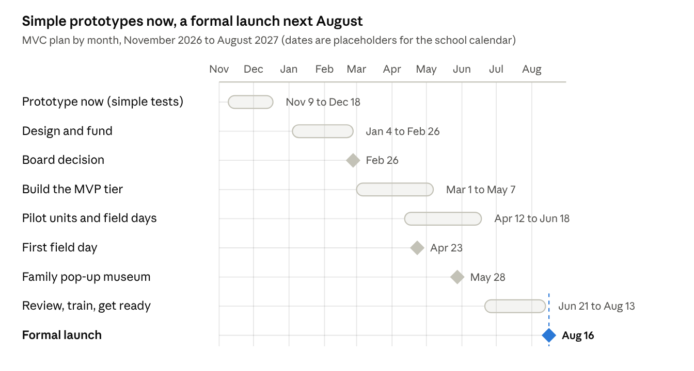

# Mini Action Plan: The Minimal Viable Classroom

Chris Davis · IBECLP 1, Fall 2026 (Western University) · Draft, November 9, 2026

## Starting point

This plan turns an underused campus space into a Minimal Viable Classroom (MVC). Simple prototypes begin now, in November 2026, and the formal launch is in August 2027. The MVC will be a shared space for the PYP, the MYP and the community, and a launchpad for learning at eight nearby sites.

The idea grew from teaching in a shipping-container classroom at Maglares Discovery School (MDS). Every classroom should hold only what serves learning. The MVC applies that rule strictly: only what is absolutely necessary, shaped by the constraints of the space. At MDS those constraints were partly intentional and partly budget. A pop-up or mobile classroom meets the same limit another way: you can't transport a whole classroom, but you can still set up an MVC.

The frame is "Where there is no ___", after Werner's *Where There Is No Doctor* (1977). The room runs from where there is no power to the highest tech: a ceiling grid with drop-in projectors and microphones, and a room that can become one projected display. It is intentional, not low-tech. Nothing goes on a table unless it serves that lesson.

The space serves several parts of the school. PYP classes use it for units of inquiry and the Exhibition. MYP classes use it for sciences, design, individuals and societies, and the personal and community projects. The library hosts and lends the kit, with a named technology lead for hardware. Families and the wider community use it for pop-up museum exhibitions.

The working model is the [MVC 3D model, tech inventory and field-site mockups](../index.html). Sizes in it are placeholders until the prototype site is chosen.

## Action plan

Five practices take the school from a prototype to a launch. Each one closes a gap named against the IB *Programme standards and practices* (PSP, 2020) and draws on the leadership intelligences (Calnin et al., 2018).

| Practice to develop | IB requirement (PSP 2020) | How I would lead it (actions and dates) | Leadership intelligences | Supporting research |
| --- | --- | --- | --- | --- |
| **1. Prototype the MVC in an underused campus space.** Gap: no costed inventory, no total-cost plan, no data on how such a space performs. | 0201-05-0100 fund adequate resources · 0202-01-0300 effective learning spaces · 0202-01-0500 flexible, collaborative space design · 0202-02-0400 spaces that meet all students' needs · 0201-04-0200 data on operation and sustainability | Nov–Dec 2026: audit underused spaces; choose one with students; log heat, humidity, noise and power for four weeks. Jan 2027: "Where there is no ___" design workshop; tiered budget with total cost of ownership. Feb–Apr 2027: build the MVP tier (ceiling grid, board rails, pack-away storage) for six formations. May 2027: present the costed prototype to the board. Measures: every item catalogued; set up and packed away in an agreed time; a full day on battery power. | Strategic: one room becomes a model for the school's growth plan. Entrepreneurial: a lean prototype, using what the school has before buying. Reflective: decisions rest on the four-week data. | Ries (2011), the minimum viable product; Barrett et al. (2019), infrastructure and learning; Thornburg (2013), campfire, watering hole and cave |
| **2. Intentional tools: nothing on the table unless it serves the lesson.** Gap: screen-time debates end in a ban or business as usual, and students' talk, sketches and notebooks go uncaptured. | 0403-05-0500 multiple technologies to aid and extend learning · 0404-02-0111 (PYP) document and analyse learning over time · 0402-01-0100 develop approaches to learning · 0403-01-0300 exploratory learning environments | Dec 2026: co-create five lesson setups, each naming the minimum kit. Jan–Mar 2027: install the capture layer (document camera, table and ceiling mics, transcription, short-throw and clip-in projectors). Mar 2027: consent and privacy protocol for recording, written with students and linked to the academic integrity policy (0301-03). Apr–Jun 2027: pilot in two units. Measures: every unit planner names its setup and why; each student shows evidence in three modes (talk, sketch, writing) per unit. | Pedagogical: the lesson decides the kit. Heuristic: judging each lesson's minimum; balancing capture with privacy. Reflective: captured work becomes evidence for reviewing practice. | UNESCO (2023), technology only where it improves learning; Jewitt (2005) and IB (2018), multimodality; Giudici, Rinaldi & Krechevsky (2001), documentation; Hattie & Hamilton (2018), cargo cults |
| **3. The classroom goes wherever we are.** Gap: the prototype is fixed; field days need a portable kit, a day base and a shared procedure. | 0202-01-0600 an active library of people, places, collections and services · 0202-03-0100 / 0300 wellbeing · 0202-02-0400 access for all students · 0201-04-0100 documented procedures | Feb 2027: pack the field cases (tarp kit, folding tables, laser projector, power station, Starlink Mini). Mar 2027: write the field manual, the school's own *Where There Is No Doctor* (risk-benefit template, ratios, first aid, setup and teardown). Mar 2027: the library runs check-out on the Library of Things model, with a named technology lead. Apr–May 2027: first day trips (farm, river). Measures: a day base up in under 45 minutes; every item returns; a risk assessment for every trip. | Entrepreneurial: the library model repurposed; site partnerships. Heuristic: risk-benefit judgment in uncertain settings. Relational: ownership shared by library, teachers and students. | IB (2018), *Ideal libraries*; Brussoni et al. (2015), risky outdoor play; Werner (1977) |
| **4. Learn from our immediate places along an IB pathway.** Gap: rich sites nearby (farm, waterfall, river, horse ranch, mountain, mangrove beach, museum, pueblo plaza) are used occasionally, with no progression from PYP to MYP. | 0202-05-0100 wider-community resources · 0403-03-0100 / 0200 local and global contexts · 0401-01-0200 vertical articulation · PYP 0402-06-0211 the Exhibition · MYP 0402-06-0221 personal and community projects; 0402-05-0221 service learning | Nov 2026–Jan 2027: map each site (access, risk, partner, season, concepts). Feb 2027: a provocation bank that starts from the senses. Mar 2027: a vertical pathway from nearby day sites (early PYP) to multi-day and community work (MYP). Apr–Jun 2027: pilot two place-based units. Aug 2027: one site per grade per term in the launch plan. | Pedagogical: provocation and documentation at the core of inquiry. Cultural: local knowledge of the land, students' identities and languages. Relational: landowners, families and experts as co-teachers. | Sobel (2004), place-based education; Kuo, Barnes & Jordan (2019), nature and learning |
| **5. Communicate through documentation, not announcements.** Gap: less screen time, outdoor learning and managed risk can look like "less school" to families. | 0201-04-0400 families understand the programme · 0202-05-0200 guardians contribute · 0401-03-0100 inform the community · 0202-03-0400 open communication · 0203-03-0100 teacher collaboration time | Dec 2026: baseline survey and listening sessions, with low-pressure channels. Jan 2027: a shared rationale in the community's languages. Feb 2027 onward: a weekly post of real student work (past, present, future). May 2027: a family pop-up museum. Jun 2027: repeat the survey. Aug 2027: launch event. Measures: more families can explain the rationale; number of family and site partners. | Relational: trust through consistency. Cultural: reading how different families engage. Strategic: one vision across audiences. | Epstein et al. (2018); Kotter (1996); Meyer (2014) |

## Link to authorization

The five practices produce the evidence the IB looks for when it authorizes a school. The *Guide to school authorization* (IB, 2010, updated 2016) asks a school applying for candidacy to show it has costed implementation in a five-year budget; practice 1's tiered budget with total cost of ownership is that budget for the MVC. Its Standard B2 (resources and support) names the practices the MVC strengthens:

- **Dedicated time for collaborative planning and reflection:** the fortnightly planning time in practice 5 and the shared unit planners in practices 2 and 4.
- **Learning environments, facilities and specialized equipment that support the programme:** the MVC itself (practices 1 and 2).
- **A library that plays a central role:** the library hosts and lends the kit (practice 3).
- **Using the community's resources and expertise:** the eight field sites and their partners (practice 4).
- **Resources for the PYP Exhibition and the MYP personal project:** the space, kit and sites are open to both (practice 4).

At the verification visit, the IB team gathers evidence that requirements are met and notes practices beyond them. The MVC's catalogue, space data, logs and student documentation are that evidence.

## How the leadership intelligences carry the plan

All seven intelligences (Calnin et al., 2018) are needed, but each one leads different practices. The table shows where each one leads (L) and where it supports (s). The notes below name the PSP practices each one activates and why it fits, in the pattern of my leadership intelligences mind map: the reading that defines it, and evidence from my own work.

| Intelligence | 1. Prototype the MVC | 2. Intentional tools | 3. Classroom goes anywhere | 4. Immediate places | 5. Communication |
| --- | --- | --- | --- | --- | --- |
| Strategic | L | | | s | L |
| Cultural | | | s | L | L |
| Entrepreneurial | L | s | L | | |
| Relational | | | L | L | L |
| Reflective | L | L | s | | |
| Heuristic | s | L | L | | |
| Pedagogical | | L | s | L | |

### Strategic: vision into systems

Seeing the big picture and turning a shared vision into systems that outlast any one leader. In this plan it leads the prototype (1) and the communication plan (5), and shapes the PYP-to-MYP pathway (4).

- **0101-01-0100:** mission, vision and strategy reflect the IB mission (Purpose).
- **0201-05-0100:** fund adequate resources to implement the programme.
- **0201-04-0200:** capture and use data on operation and sustainability.
- **0401-01-0200:** articulate the curriculum horizontally and vertically.
- **0401-03-0100:** inform the community of programme developments.

**Why it fits:** the MVC is designed as a system, not a project. A tiered budget with total cost of ownership, a phased timeline to August 2027, and one pathway from PYP to MYP keep the space alive when staff change. Prototyping first gives teachers a baseline before anything new is bought.

**Evidence:** "…responding appropriately to the present, creating the future and anticipating the consequences" (MacGilchrist et al., quoted in Calnin et al., 2018, p. 106). Dr. X, the school leader I interviewed, put the order plainly: "You have to establish consistency before you allow innovation."

### Cultural: context and difference

Reading context and difference, and building intercultural understanding across the whole community. It leads the field-site pathway (4) and the communication plan (5), and supports the day bases (3).

- **0202-05-0100:** use wider-community resources that aid and extend learning.
- **0403-03-0100:** clear local and global connections in the curriculum.
- **0402-07-0100:** opportunities to explore personal and cultural identities.
- **0402-07-0300:** students develop their language profiles.
- **0301-04-0200:** the language policy treats multilingualism as a resource (Culture).

**Why it fits:** the farm, the mangrove beach and the pueblo plaza make the host country the curriculum, not its backdrop. Outdoor learning and less screen time can read as "less school" to some families, so the rationale goes out in the community's languages and through student work they can see.

**Evidence:** "These places are not empty containers waiting for an imported curriculum to give them intellectual substance" (Cailey, 2026). Dr. X: "…if you can't tell where you are in the world by looking around the school, the school isn't representing its country."

### Entrepreneurial: opportunity and change

Creative, discovery-driven engagement with opportunities, partnerships and change. It leads the prototype (1) and the portable kit (3), and supports the capture layer (2).

- **0202-01-0500:** design learning spaces for flexibility and collaboration.
- **0202-01-0600:** an active library of people, places, collections and services.
- **0202-01-0400:** technologies that connect the community (Starlink, video calls).
- **0403-05-0500:** multiple technologies to aid and extend learning.
- **0402-05-0100:** students apply learning by taking action.

**Why it fits:** the plan reuses what the school already has, an underused space and the library, before buying. Farms, the ranch, the museum and the municipality become partners. Every purchase after the prototype must show impact in the pilot.

**Evidence:** Calnin et al. (2018, p. 107) single out "active, creative and discovery-driven engagement". Hattie and Hamilton (2018) set the limit: "that diversity must come with evidence of impact."

### Relational: trust and care

Building trust and ethical relationships that make collaboration and professional risk-taking possible. It leads the field days (3), the site partnerships (4) and the communication plan (5).

- **0202-05-0200:** meaningful opportunities for legal guardians to contribute.
- **0202-03-0400:** open communication based on understanding and respect.
- **0203-03-0100:** dedicated time for teachers to plan and reflect together.
- **0403-04-0100:** teachers collaborate for a coherent learning experience.
- **0402-03-0300:** opportunities for student voice.

**Why it fits:** managed outdoor risk, recording students and teachers trying new formations all depend on trust. Students co-design the space and write the use and consent rules; families become site hosts and exhibition audiences.

**Evidence:** trust is what encourages "a positive attitude to risk taking" (Tschannen-Moran, in Calnin et al., 2018, p. 108). From my own work: "Families do not need more information; they need a frame."

### Reflective: evidence of impact

Evaluating practice and one's own impact, and being willing to question received wisdom. It leads the prototype (1) and the intentional-tools pilot (2), and supports the field manual (3).

- **0201-04-0300:** use data on the quality of implementation.
- **0403-01-0200:** monitor and evaluate inquiry-based teaching.
- **0404-02-0111 (PYP):** document and analyse learning over time.
- **0402-02-0200:** students reflect on their learner profile growth.

**Why it fits:** four weeks of space data, tech-use logs, repair and incident logs, and captured transcripts and photos give the June review real evidence. The same captures are student documentation, so reflection costs teachers less time.

**Evidence:** "Collect evidence to know thy impact" (Hattie & Hamilton, 2018). From my recruitment forum: "…we trust our judgment, but we test it against evidence."

### Heuristic: judgment in context

Sound judgment in complex, time-pressured situations: knowing when to act on experience and when to pause. It leads the intentional-tools rule (2) and the field days (3), and supports the prototype (1).

- **0202-03-0200:** systems and policies attend to wellbeing (risk-benefit assessment).
- **0202-02-0400:** use learning spaces to meet the needs of all students.
- **0403-05-0100:** consider learner variability when planning.
- **0301-06-0300:** policies consider physical and virtual spaces (Culture).

**Why it fits:** no rule decides what a lesson's minimum is, how close is too close to the river, or when recording helps more than it intrudes. The plan gives teachers a purpose test and a risk-benefit template, then trusts their judgment on the day.

**Evidence:** "everything seems to work somewhere and nothing everywhere" (Wiliam, quoted in Hattie & Hamilton, 2018). Dr. X: "There's no such thing as a rule. You have to build for your context."

### Pedagogical: leading learning

Leading the study of teaching and learning so the school works as a community of learners. It leads the intentional tools (2) and the place-based pathway (4), and supports the field days (3).

- **0403-01-0100:** inquiry-based teaching and learning.
- **0403-01-0300:** interactive, exploratory learning environments and play.
- **0401-02-0100:** teachers plan units together.
- **0402-01-0100:** develop approaches to learning (ATL).
- **0402-06-0211 (PYP) and 0402-06-0221 (MYP):** the Exhibition, and the personal and community projects.

**Why it fits:** pedagogy drives the kit. Lesson setups, the campfire, water hole and cave formations, and multimodal capture all exist to make student thinking visible and to measure impact on students, not teacher performance.

**Evidence:** watch "not the teacher, but the impact of the teacher" (Hattie & Hamilton, 2018). From my PYP reflection: "…PYP assessment leans toward monitoring and documenting rather than heavy measuring."

## Timeline

Prototyping starts this month with what the school already has, and the formal launch is August 16, 2027, the start of the school year. Each phase tests a smaller version of the next.

The build and the pilot overlap on purpose: what the first units reveal shapes the last purchases before the board's budget is spent.

**Simple prototypes for November and December 2026**

1. Tape out a 40 × 8 ft footprint in the chosen space and teach one lesson with only that lesson's setup on the tables.
2. Run a campfire: a half moon of chairs facing a borrowed projector, with one discussion recorded and transcribed.
3. String one wall with cord and clips for a class display, the seed of the pop-up museum.
4. Hold a day-base test on campus: a tarp, two tables and a power station for a full school day outdoors.
5. Take one field visit to the farm or the river with a tote of kit and a borrowed laser projector, and note what was missing.

## MYP technology and Raspberry Pi sensors

The MYP layer adds a sensing and making kit built on Raspberry Pi. Students build their own instruments, collect data in the room and at field sites, and read it on a local dashboard that works without the internet. The same kit serves PYP inquiry with simpler parts (micro:bit), so one investment covers several parts of the school. Quantities assume one class of up to 24 MYP students working in pairs or threes; models are a starting spec to confirm with a supplier.

| Item | Qty | Spec | MYP use |
| --- | --- | --- | --- |
| Raspberry Pi 5 kits (4 GB, case, power supply, microSD) | 8 | Runs Python, logs data, hosts a local dashboard | Sciences B and C (inquiring and designing; processing and evaluating) · Design C (creating the solution) |
| Raspberry Pi Pico W boards | 12 | Low-power loggers that run for days on a battery | Long field deployments at the river, farm and mangrove beach |
| Sensor sets (no-solder connectors) | 6 sets | Temperature, humidity and pressure · soil moisture · waterproof water-temperature probe · pH and turbidity · light · sound level · air quality (particulates) · GPS | Sciences fieldwork; individuals and societies (B investigating) on noise, air and land use |
| Camera modules | 4 | Time-lapse and wildlife capture | Sciences observation; Design documentation |
| Weatherproof enclosures, stakes, solar power banks | 6 | Field stations that survive rain and humidity | Design C and D (creating, evaluating) |
| Breadboards, jumper wires, a soldering station | class set + 1 | No-solder start; soldering for older MYP | Design C |
| Small 3D printer | 1 | Enclosures and prototypes, powered from a ceiling drop | Design B and C (developing ideas, creating) |
| micro:bit kits | 13 | The bridge from PYP coding to Raspberry Pi | PYP inquiry; early MYP |
| Local dashboard on a Raspberry Pi | 1 | Shows live data on the room's displays; syncs to the Mac mini hub; works offline | Mathematics D (applying mathematics in real-life contexts) |

**How the space serves the school**

- **PYP:** units of inquiry, the Exhibition, campfire storytelling and the field sites.
- **MYP:** sciences and design investigations, interdisciplinary units, service as action, and the personal and community projects.
- **Library:** hosts the kit and runs check-out, with a named technology lead for hardware and sensors.
- **Staff:** the room doubles as a workshop and conference space, using the ceiling power drops, mics and screens.
- **Families and community:** pop-up museum exhibitions in the room, in the covered area and in the pueblo plaza.

## Leadership foresight

The biggest risk is a room that fills with kit nobody planned for. The lesson-setup rule and the catalogue are the guard against it. Other risks and how the plan meets them:

- **Implementation dip:** the first prototypes and field days will be clumsy (Fullan, 2001). Time is budgeted for it, and short wins are celebrated (Kotter, 1996).
- **Sustainability:** equipment needs a replacement cycle and a maintenance budget from year one, or it turns into storage.
- **People:** no single champion or librarian carries the space; the library, a named technology lead and at least three trained teachers share it, avoiding the "super librarian" trap (IB, 2018).
- **Equity and access:** every student takes part in field days; transport, mobility, cost and consent are planned per site (0202-02-0400).
- **Safety and permissions:** a risk-benefit assessment for every trip; written permission to project in the museum and the plaza; site agreements with the farm and the ranch.
- **Privacy:** recordings, transcripts and sensor data follow the consent protocol and stay on local storage.
- **Weather and seasons:** field days are scheduled around the rainy and dry seasons, with an indoor fallback for each.

## References

Check editions and author lists before submission; details marked from memory are approximate.

- Barrett, P., Treves, A., Shmis, T., Ambasz, D., & Ustinova, M. (2019). *The impact of school infrastructure on learning: A synthesis of the evidence*. World Bank.
- Brussoni, M., et al. (2015). What is the relationship between risky outdoor play and health in children? A systematic review. *International Journal of Environmental Research and Public Health, 12*(6), 6423–6454.
- Cailey, R. J. (2026, October 31). The educational singularity. *Nomadic Notes*, LinkedIn.
- Calnin, G., Waterson, M., Richards, S., & Fisher, D. (2018). Developing leaders for International Baccalaureate World Schools. *Journal of Research in International Education, 17*(2), 99–115.
- Davis, C. (2026). *IB leadership intelligences and measuring student learning in the PYP*; *Week 3 forum: Recruitment and leadership intelligences*; *Culture, context and stakeholder engagement in IB schools: Reflective responses*. IBEC Module 1 coursework.
- Dr. X (anonymised school leader). (2026, November 4). Interview by C. Davis [Transcript]. IBEC Module 1 school leader interview.
- Epstein, J. L., et al. (2018). *School, family, and community partnerships* (4th ed.). Corwin.
- Fullan, M. (2001). *Leading in a culture of change*. Jossey-Bass.
- Giudici, C., Rinaldi, C., & Krechevsky, M. (Eds.). (2001). *Making learning visible*. Project Zero & Reggio Children.
- Hattie, J., & Hamilton, A. (2018). *Education cargo cults must die*. Corwin.
- International Baccalaureate Organization. (2010, updated 2016). *Guide to school authorization: Primary Years Programme*.
- International Baccalaureate Organization. (2015). *The integration of technology in the Diploma Programme* (research summary).
- International Baccalaureate Organization. (2018). *Ideal libraries: A guide for schools*.
- International Baccalaureate Organization. (2020). *Programme standards and practices*.
- Jewitt, C. (2005). Multimodality, "reading", and "writing" for the 21st century. *Discourse: Studies in the Cultural Politics of Education, 26*(3), 315–331.
- Kotter, J. P. (1996). *Leading change*. Harvard Business School Press.
- Kuo, M., Barnes, M., & Jordan, C. (2019). Do experiences with nature promote learning? *Frontiers in Psychology, 10*, 305.
- Meyer, E. (2014). *The culture map*. PublicAffairs.
- Ries, E. (2011). *The lean startup*. Crown Business.
- Sobel, D. (2004). *Place-based education*. Orion Society.
- Thornburg, D. (2013). *From the campfire to the holodeck*. Jossey-Bass.
- UNESCO. (2023). *Global education monitoring report 2023: Technology in education: A tool on whose terms?*
- Werner, D. (1977). *Where there is no doctor*. Hesperian.
